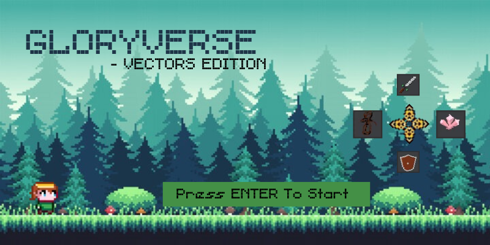
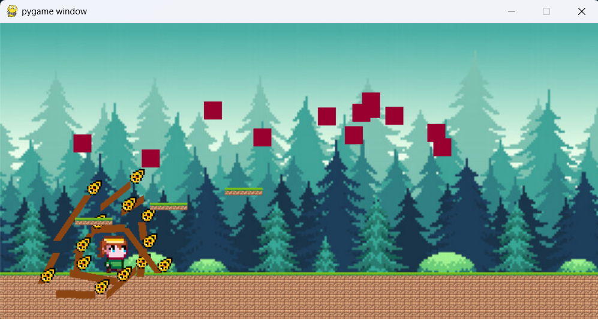
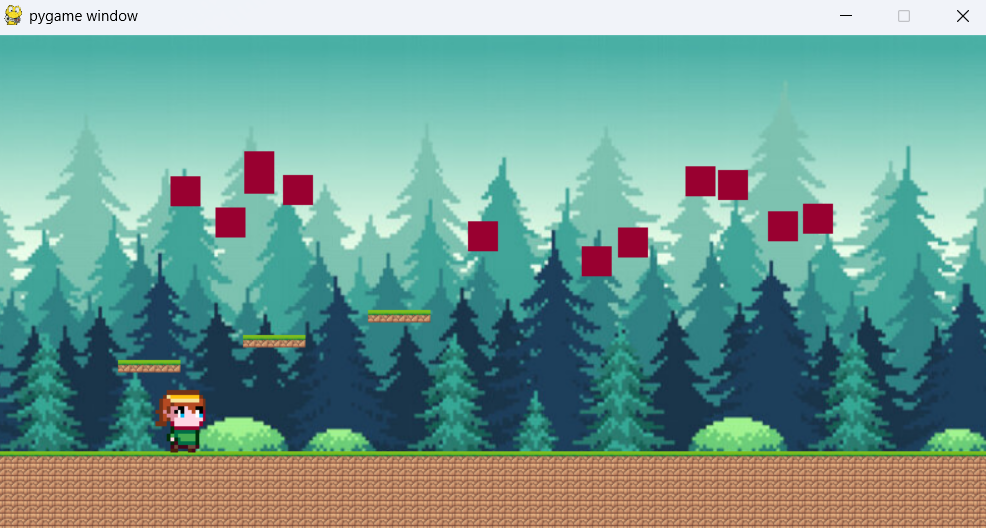
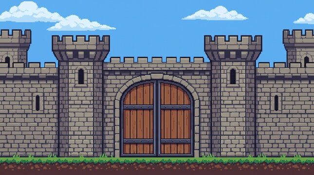
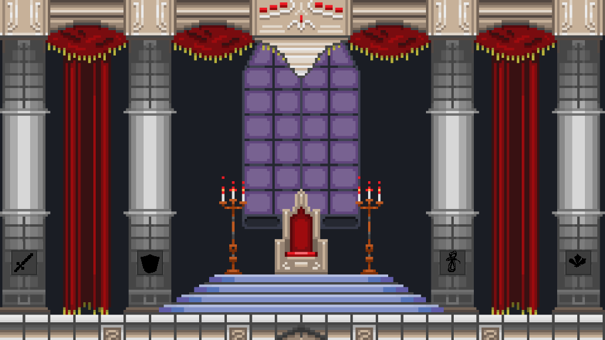

# Glory Verse

It is a game based on vectors from math, for attack and movement and consist of 5 levels, and some animations. In my opinion, as its developer, it has potential which has been hidden. 

## Description

Let's start with keybinds:

Mouse click: 
- press in: forms a vector
- press out: finalises the vector

Just play once and you would get the hand of it.

Pressing Q starts preparing mode, allowing multiple vectors to form and "freeze" and pressing Q again releases all those vectors allowing their effect to descend.

R - restarts to level 1 (where red enemies were present) in case you die
Enter/Esc key - Starts the game from start menu

A, W, D - right, up, left movement. Up here refers to jump. Though consider avoiding it as it's just a sort of cheat code in case using vectors everytime feels hard to your fingers (especially on a touchpad).

C - picks up items present in proximity. It's the most important and will show its worth in throne room.

K - allows you to insert items automatically near slots in throne room.

"X" button on top right - Gives 100 BTC. Try it when you reach throne room, just before inserting the items.

## Screenshots

| Title screen | Drawing vectors | Enemies in the field |
|---|---|---|
|  |  |  |
| **Bridge and wave** | **Castle wall** | **Throne room / win** |
|  |  |  |

(Kept AI Here because it looks very good and I have no idea about MarkDown. Sorry!)

## Getting Started


### 1. Get the code

```bash
https://github.com/MatchMaker-Owner/Pixl.git
cd Pixl
```

### 2. (Recommended) create a virtual environment

```bash
python -m venv .venv

# Windows
.venv\Scripts\activate

# macOS / Linux
source .venv/bin/activate
```

### 3. Dependencies

- Python 3.8 or newer (Check on cmd using `python --version`)
- `pip` - It's included in your python installation, hopefully. Else, another headache for you.
- pygame - download using "pip install pygame" in cmd/terminal. Explained below more thoroughly.

### 4. Installing pygame

```bash
pip install pygame
```

Check it worked:

```bash
python -c "import pygame; print(pygame.version.ver)"
```

### 5. Run the game

Run it **from the project folder**. Considering you ran both commands in step 2, it would be already done. Else, find the location of your folder and use:

```bash
cd folder_path
```

And then:

```bash
python main.py
```

There's no further command to give. Since it's a game, all inputs are keyboard based without any typing required in cmd/terminal/idle where the program is running.
code blocks for commands


## Help

To fix error issues:
```
try:
[Insert tab ->]{Block where the error came}
except:
[insert tab ->]pass
```

This has been done in 2 places in code too. My brain was fatigued and I had almost zero clue to solve the bug. Hence, I used it. Also, I did many experiments to confirm my code and also thoroughly checked it many times which was a very messy experience considering my "tidy" code. So, any bug or issue would be a surprise for me. In such a case, please share it with me at: platform.matchmaker@gmail.com.

Thank you in advance.

## License

This project is licensed under the Unlicense License - see the LICENSE.md file for details. Copy pasted it with minimal changes to retain the crisp legal wordings. But read it through still.